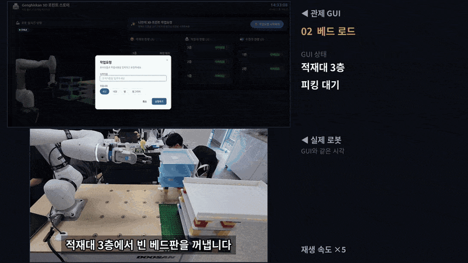
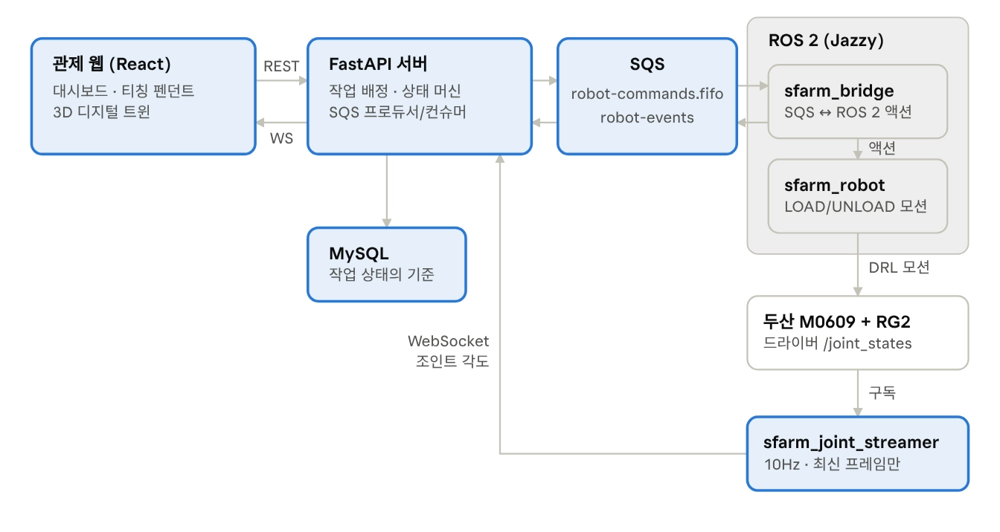

> 두산로보틱스 ROKEY 부트캠프 10기에서 5인 팀으로 진행한 **3Farm** 프로젝트 입니다. 두산 협동로봇(M0609) 한 대가 3D 프린터 3대를 무인으로 운영하는 시스템으로, 전체 아키텍처 설계와 WAS 개발, 웹 기반 티칭 펜던트, ROS 2 조인트 스트리머, 3D 디지털 트윈 개발을 맡았다. 로봇이라는 "한 번에 하나만 점유 가능한 자원"을 서버가 어떻게 상태로 통제했는지, 그 과정에서 겪은 트러블슈팅을 중심으로 정리했습니다.

  

## 프로젝트 개요

- **프로젝트명**: 3Farm
- **소속**: 두산로보틱스 ROKEY 부트캠프 10기, 5인 팀
- **일정**: 2026.11.09 ~ 2026.11.20 (2주)
- **역할**: 시스템 아키텍처·ERD 설계, WAS 개발, 웹 기반 티칭 펜던트 제어 기능 구현, ROS 2 스트리머 노드 개발, 3D 디지털 트윈 개발
- **하드웨어**: Doosan M0609 + OnRobot RG2 그리퍼, 3D 프린터 모형 3대, 보드 적재대 모형 3층, 수령대 모형 2칸
- **기술 스택**: Python, FastAPI, SQLAlchemy, MySQL, AWS SQS(FIFO), WebSocket, ROS 2 Jazzy, React + TypeScript, Three.js(urdf-loader), Docker
- **Github**: [github.com/baeksewoong/genghiskan_ros2](https://github.com/baeksewoong/genghiskan_ros2)

무인 3D 프린트 업장 운영 시스템이다. 키오스크로 주문이 들어오면 순서대로 대기열에 쌓이고, 로봇팔이 비어있는 프린터에 베드를 채우는 과정과 완료된 결과물을 수령대에 꺼내는 과정을 자동으로 처리한다.

  

## 시스템 아키텍처

*관제 웹(React)이 REST로 FastAPI 서버에 작업을 요청하면, 서버는 MySQL로 작업 상태를 관리하며 SQS(robot-commands.fifo / robot-events)로 ROS 2 쪽과 통신한다. sfarm_bridge가 SQS 메시지를 ROS 2 액션으로 변환해 sfarm_robot에 LOAD/UNLOAD 모션을 지시하고, 두산 M0609 + RG2 드라이버가 이를 수행한다. sfarm_joint_streamer는 `/joint_states`를 10Hz로 구독해 최신 프레임만 WebSocket으로 관제 웹에 전달한다.*

| 결정 | 이유 |
| --- | --- |
| 서버 ↔ ROS 2는 SQS 큐 2개(commands/events)로 통신 | 로봇 쪽과 서버 쪽을 따로 개발, 재시작 가능. 로봇이 작업 중일 때 들어온 요청은 큐에 쌓아 순서대로 처리 |
| WebSocket으로 로봇팔 동작을 실시간 반영 | 10Hz로 계속 흐르는 데이터라 큐에 쌓을 필요가 없고 최신 값만 의미 있음 |
| 작업 상태관리는 MySQL | 이벤트가 몰려도 "지금 로봇이 무엇을 하는가"를 한 곳에서 판단 → 로봇이 점유하는 task를 1개로 제한 |
| 모션을 load1/load2, unload1/unload2로 분리 | 실패한 단계만 재시도해 이미 끝난 동작을 반복하지 않음 |

SQS를 명령(commands)과 이벤트(events) 두 큐로 나눈 이유는 단순하다. 서버와 로봇 쪽 코드베이스를 독립적으로 개발/배포/재시작할 수 있게 하고 싶었고, 로봇이 하나뿐이라 동시에 두 가지 일을 할 수 없으니 들어온 요청은 일단 큐에 쌓아 순서대로 처리하게 만들었다.

  

## 주요 기여 및 작업 내용

전체 시스템 아키텍처 설계와 웹서버 개발을 맡았고, 그 외에 웹소켓 기반 3D 디지털 트윈과 웹 티칭 펜던트를 구현해 직접교시 없이도 미세 좌표를 찾을 수 있게 했다.

### 1. 작업 배정 서버

- 주문 접수부터 보드 투입, 프린터 타이머, 회수, 수령까지 로봇 동작을 스케줄링
- SQS를 통해 로봇의 다음 작업을 전달
- 웹소켓으로 ROS 2 노드로부터 로봇 데이터를 받아 UI에 실시간 반영
- 기술: FastAPI, Python, REST API, WebSocket, MySQL, SQS

### 2. 관제 대시보드

- 대기 중인 작업, 프린터 3대의 상태와 남은 시간, 적재대 재고, 수령대 현황, 작업 히스토리를 확인할 수 있는 대시보드 개발
- 서버가 상태 변화를 WebSocket으로 밀어 주어 새로고침 없이 갱신
- SQS 모니터링으로 오고 간 메시지를 확인해, 로봇 담당 팀원들과 연동 문제를 파악
- 기술: React, TypeScript, WebSocket

### 3. 웹 티칭 펜던트

- 브라우저에서 로봇팔을 관절/좌표 기준으로 조그 이동하고 그리퍼를 열고 닫는 기능 구현
- 현재 좌표를 기준으로 미세 좌표를 튜닝할 때 사용
- 기술: React, FastAPI, SQS, ROS2, M0609, RG2 Gripper

### 4. ROS 2 조인트 스트리머 노드와 3D 디지털 트윈

- 두산 드라이버의 `/joint_states`를 구독해 6축 각도를 백엔드 WebSocket으로 전달하는 ROS 2 노드 개발
- 프론트는 M0609 + RG2 URDF 모델에 이 각도를 반영하고, 작업대·적재대도 실제와 동일하게 렌더링
- **구독 전용 노드로 분리**: 다른 패키지를 건드리지 않아 팀원이 개발 중인 모션·브릿지 코드에 영향을 주지 않음
- **최신 프레임만 전송**: 10Hz로 스로틀링하고, 실시간 자세에서는 과거 값이 의미 없으므로 밀린 프레임은 버리고 최신 값만 전송
- **소켓 연결 실패 처리**: 연결이 끊기면 지수 백오프로 재연결
- **그리퍼 상태 보완**: RG2 그리퍼는 `/joint_states`에 없고 컨트롤박스를 5Hz로 polling해 디지털 출력으로 제어. on/off만 알 수 있어 열림/닫힘은 애니메이션으로 구현
- 기술: WebSocket, ROS2, M0609, RG2 Gripper, Three.js, URDF

  

## 트러블슈팅

### 1. 작업 중 들어온 이벤트가 로봇 동작 순서를 꼬이게 함

- **문제**: load 과정은 load1과 load2 두 동작을 이어서 수행하는데, load1 동작 중에 다른 이벤트가 들어오면 load2를 이어가지 않고 새 이벤트의 동작을 처리했다. 로봇이 보드를 잡은 채로 다른 동작을 하는 상황이 발생했다.
- **원인**: 이벤트가 오는 즉시 명령을 발행했기 때문에, "로봇이 지금 무엇을 하고 있는가"를 확인하지 않았다.
- **해결**: 이벤트는 DB 상태로만 기록하고, 로봇이 작업 완료를 보낼 때마다 서버가 상태를 보고 다음 명령을 골라 보내도록 변경했다. 로봇이 점유하는 작업을 1개로 제한했다.
- **배운 점**: 자원이 하나뿐이면 "언제 보낼지"를 이벤트가 아니라 상태로 판단해야 순서에 맞게 동작을 제어할 수 있다.

### 2. 집기 실패 후 재시도한 명령이 SQS에서 사라짐

- **문제**: 적재대에서 보드 집기에 실패해 같은 작업을 다시 보냈는데 로봇이 반응하지 않았다.
- **원인**: FIFO 큐는 같은 deduplication id로 5분 안에 들어온 메시지를 버린다. 재시도가 첫 전송과 같은 `load-{id}`를 dedup id로 쓰고 있던 게 원인이었다.
- **해결**: 재시도할 때는 dedup id에 uuid를 붙여 새 메시지로 보내도록 처리해 메시지가 버려지지 않게 했다.
- **배운 점**: 중복 제거는 "실수로 두 번 보낸 요청"과 "의도한 재시도"를 구분하지 못하므로, 재시도에는 별도 식별자가 필요하다.

### 3. 수령대가 차면 로봇이 보드를 든 채 멈춤

- **문제**: unload 과정은 unload1과 unload2 두 동작을 이어서 수행하는데, 출력이 끝난 프린터에 곧바로 unload1을 발행했더니 수령대 2칸이 모두 차 있을 때 로봇이 보드를 꺼낸 뒤 놓을 곳이 없어 멈췄다.
- **해결**: 출력 완료 시 수령대에 빈칸이 있는지 먼저 확인하고 unload1을 발행하도록 수정했다. 빈칸이 없으면 기다렸다가 자리가 생기면 unload1을 수행하도록 변경했다.
- **배운 점**: 되돌리기 어려운 물리 동작은 명령을 보내기 전에 끝까지 수행할 수 있는지를 먼저 확인해야 한다.

---

## 결과

- 주문 접수부터 보드 투입·프린터 운영·회수·수령까지 로봇 1대로 3D 프린터 3대를 무인 운영하는 시스템을 2주 만에 구현
- 로봇의 "작업을 1개로 제한"하는 상태 기반 스케줄링으로, 동시 이벤트가 몰려도 동작 순서가 꼬이지 않도록 함
- 웹 티칭 펜던트와 3D 디지털 트윈으로 직접교시 없이도 미세 좌표 튜닝이 가능해져, 로봇 담당 팀원의 좌표 조정 작업을 지원

## 회고

7년간의 웹 풀스택 개발 경험으로 시스템 아키텍처를 빠르게 설계할 수 있었다.

다만 티칭 펜던트 세션 상태를 DB가 아닌 서버 메모리에 두어, 서버가 재시작되면 세션이 사라졌다. 운영 환경이라면 영속화가 필요한 부분이다.

프로젝트 수행 중 로봇이 예상치 못한 동작으로 하드웨어 구성품과 충돌해, 폼보드로 만든 구성품이 부서져 다시 만든 적이 있었다. 충돌 감지로 "안전 정지" 기능을 먼저 구현했다면 사전에 방지할 수 있는 상황이었다. 협동로봇 특성상 안전 기능을 가장 먼저 고려했어야 했는데, 그 점을 놓친 게 가장 아쉽다.

작업을 순서대로 처리하기 위해 SQS FIFO 를 사용했지만 로봇이 1대뿐인 1:1 통신 구조에서 SQS는 필수가 아니었고, 백엔드 DB를 기준으로 한 REST 폴링으로도 충분히 커버 가능했다. 오히려 FIFO dedup 버그와 AWS 자격증명 관리 부담만 늘었다.